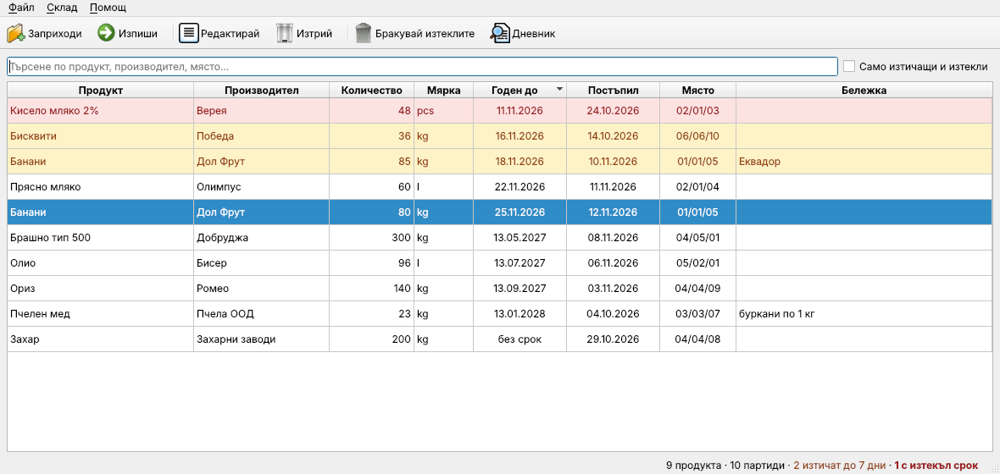
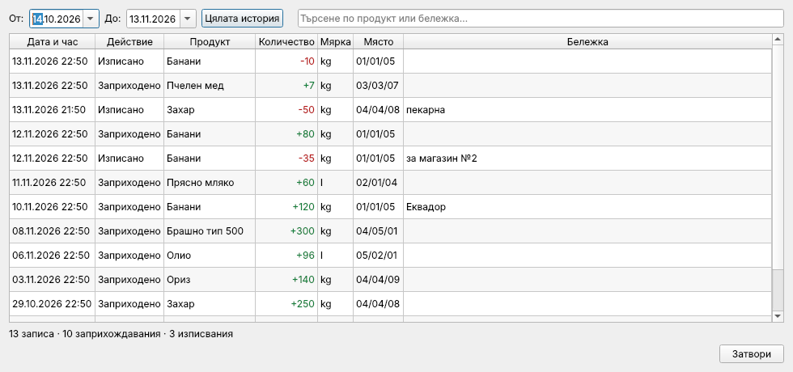

# storage

[](https://github.com/Daneto123/storage/actions/workflows/build.yml)

**Складова програма с Qt прозорец.** С нея се заприхождава и изписва стока, следят се сроковете на годност и местата в склада, а всяко движение се записва в дневник. Данните се пазят във файлове, които се отварят и с Excel.

Първата версия е писана по предмета „Обектно-ориентирано програмиране“ през летния семестър на 2019/2020 г. на C++ като конзолна програма. Тя е запазена непроменена в бранча [`university-2020`](https://github.com/Daneto123/storage/tree/university-2020), заедно с първия опит за Qt интерфейс от 2024 г. Оригиналната документация е в [documentation.pdf](documentation.pdf).



## Какво може

- **Заприхождаване** (`Ctrl+N`): продукт, производител, количество и мярка, срок на годност, дата на постъпване, място (секция / рафт / място) и бележка. Ако името на продукта вече е в склада, производителят, мярката и мястото се попълват сами. Еднаква партида се слива със съществуващата, а не се дублира.
- **Изписване** (`Ctrl+I`): първо се изписват партидите с най-близък срок на годност (FEFO). Изтеклите не се изписват. Ако стоката не стига, програмата казва колко има.
- **Срокове на годност**: изтеклите партиди са в червено, тези, които изтичат до 7 дни, са в жълто. Филтърът „Само изтичащи и изтекли“ показва само тях. „Бракувай изтеклите“ ги премахва наведнъж.
- **Места в склада**: на едно място може да има само един продукт, макар и в няколко партиди. Ако мястото е заето от друг продукт, програмата не позволява да се запише.
- **Дневник** (`Ctrl+L`): всяко заприхождаване, изписване, редакция и изтриване с дата и час, с филтър по период и търсене.
- **Търсене** (`Ctrl+F`) по всички колони и сортиране с клик върху заглавие на колона.
- **Внасяне от стария формат**: *Файл → Внеси от стария формат (2020)* прочита `product.txt` от конзолната версия. Примерен файл има в [data/legacy-products.txt](data/legacy-products.txt).



## Файлове

Всичко се записва веднага след всяка промяна, както и в оригиналната програма. Складът е два CSV файла, UTF-8, разделени с `;`, които се отварят направо в Excel:

| Файл | Съдържание |
|---|---|
| `sklad.csv` | наличностите, по една партида на ред |
| `sklad.log.csv` | дневникът с всички движения |

По подразбиране файловете са в папката с данни на програмата (*Файл → Покажи папката с файловете*). С *Файл → Нов склад…*, *Отвори…* и *Запази като…* може да се работи и с други файлове. Програмата помни последния отворен файл. Записът е атомарен, така че при спиране на тока файлът не остава наполовина записан.

## Компилиране

Нужни са Qt 6.2 или по-нов (Widgets) и CMake 3.16+.

**Qt Creator:** *File → Open File or Project* → `CMakeLists.txt` → Run.

**От командния ред:**

```bash
cmake -B build -DCMAKE_PREFIX_PATH=/път/до/Qt/6.7.1/mingw_64
cmake --build build --config Release
```

За да пуснеш програмата на компютър без Qt, копирай нужните библиотеки с `windeployqt build/StorageApp.exe`.

## Тестове

```bash
ctest --test-dir build -C Release --output-on-failure
```

Тестовете проверяват логиката на склада: сливане на партиди, заети места, изписване по срок, бракуване и дневник. Проверяват и записа и четенето на файловете, включително кирилица, кавички, `;` и нови редове в текста, както и внасянето на оригиналния файл от 2020 г. GitHub Actions ги пуска на Windows, Linux и macOS при всеки push.

## Структура

```
src/core/   логиката на склада и файловете (без интерфейс)
  product.*      продукт, място, движение
  inventory.*    заприхождаване, изписване, бракуване, дневник
  storagefile.*  CSV файлове и внасяне от стария формат
src/app/    Qt прозорецът
  mainwindow.*   главният прозорец
  productmodel.* таблицата с продуктите, оцветяване и филтър
  productdialog.*, withdrawdialog.*, logdialog.*
tests/      автоматични тестове (Qt Test)
data/       примерни данни от оригиналната версия
```
